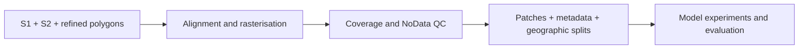

# Brazil Favela S1/S2 Post-processing

Part of my IRD master's research. **[Start with the complete project overview](https://github.com/Mahmoud-AboShukr/favela-dataset-pipeline)** for the research outcome, thesis, and links to optical acquisition, radar acquisition, and label preparation.

## At a glance

**Output:** co-registered Sentinel-1, Sentinel-2, and binary favela masks, followed by patch metadata and geographic evaluation splits. The wider research covered 26 cities and 12,699 patches; the dataset and final TerraMind experiment are not yet released here.




Public post-processing pipeline for preparing Sentinel-1, Sentinel-2, and favela label masks for a deep-learning-ready Brazil favela segmentation dataset.

This repository contains code, configuration files, documentation, and quality-control utilities. It does **not** contain satellite imagery, GeoTIFFs, H5 files, GeoPackages, shapefiles, or other large geospatial data products.

---

## Objective

The first stage of the pipeline performs three tasks:

1. Finalize Sentinel-2 products while keeping all downloaded bands.
2. Finalize Sentinel-1 products and align them to the Sentinel-2 grid.
3. Rasterize the final favela label mask on the same Sentinel-2 grid.

The goal is to transform already constructed geospatial products into a clean, aligned, reproducible dataset suitable for machine learning experiments.

---

## Data policy

Raw and intermediate input data are never modified.

Default input root:

```text
/media/HALLOPEAU/T7/my_processed_data
```

Default output root:

```text
/media/HALLOPEAU/T7/post_processing_dataset
```

The input directory is treated as read-only. All post-processed outputs are written to the separate output directory.

---

## Expected input structure

```text
/media/HALLOPEAU/T7/my_processed_data/
├── s2_images/
│   ├── brasilia_V3/
│   │   ├── city_composite_2022.tif
│   │   ├── city_cloudmask_2022.tif
│   │   └── selected_scenes_diagnostics.json
│   └── ...
├── s1_images/
│   ├── raw/
│   │   ├── brasilia/
│   │   └── ...
│   └── ...
└── polygons/
    ├── final_pipeline_scale_up/
    │   ├── brazil_refined_dissolved.gpkg
    │   └── brazil_refined_raw.gpkg
    └── polygons_clean/
        ├── favelas_clean.gpkg
        └── favelas_clean_summary.csv
```

---

## Expected output structure

```text
/media/HALLOPEAU/T7/post_processing_dataset/
├── s2_final/
│   └── <city>/
│       └── <city>_s2_allbands_10m.tif
├── s1_final/
│   └── <city>/
│       └── <city>_s1_vv_vh_vvdiff_10m_aligned.tif
├── labels_final/
│   └── <city>/
│       └── <city>_label_final.tif
├── auxiliary/
│   ├── cloud_masks/
│   └── original_polygon_masks/
├── metadata/
│   └── city_input_inventory.csv
├── qc/
│   ├── s2_finalization_qc.csv
│   ├── s1_finalization_qc.csv
│   └── label_finalization_qc.csv
└── logs/
```

---

## Dataset design philosophy

The main dataset should remain simple:

```text
S2 + S1 + final label
```

Auxiliary material is stored separately:

```text
cloud masks
quality masks
original polygon masks
alternative label masks
QC tables
metadata files
processing logs
```

This makes the dataset easy to use while preserving transparency and reproducibility.

---

## Sentinel-2 processing

The Sentinel-2 post-processing step keeps all downloaded bands.

The pipeline does not force a reduced 10-band subset at this stage, because some downstream models and foundation models may expect 12 or 13 Sentinel-2 bands.

Main Sentinel-2 output:

```text
s2_final/<city>/<city>_s2_allbands_10m.tif
```

Auxiliary cloud mask output, when available:

```text
auxiliary/cloud_masks/<city>/<city>_cloudmask.tif
```

---

## Sentinel-1 processing

The Sentinel-1 post-processing step prepares radar data aligned to the Sentinel-2 grid.

Recommended channels:

```text
Band 1: VV_dB
Band 2: VH_dB
Band 3: VV_minus_VH_dB
```

Main Sentinel-1 output:

```text
s1_final/<city>/<city>_s1_vv_vh_vvdiff_10m_aligned.tif
```

---

## Label processing

The label post-processing step rasterizes the final favela polygons onto the Sentinel-2 grid.

Main label output:

```text
labels_final/<city>/<city>_label_final.tif
```

The label is stored as a binary mask:

```text
0 = background
1 = favela
```

Original polygon masks and other auxiliary label variants should be stored separately rather than included in the main dataset.

---

## Installation

Create and activate a virtual environment:

```bash
python3 -m venv venv
source venv/bin/activate
```

Install dependencies:

```bash
pip install -r requirements.txt
```

If geospatial packages fail to install through pip, install system dependencies first or use a Conda/Mamba environment.

---

## Configuration

The default configuration file is:

```text
configs/default.yaml
```

It defines the input/output paths and processing options, for example:

```yaml
input_root: /media/HALLOPEAU/T7/my_processed_data
output_root: /media/HALLOPEAU/T7/post_processing_dataset

s2_root: /media/HALLOPEAU/T7/my_processed_data/s2_images
s1_root: /media/HALLOPEAU/T7/my_processed_data/s1_images/raw

final_label_vector: /media/HALLOPEAU/T7/my_processed_data/polygons/final_pipeline_scale_up/brazil_refined_dissolved.gpkg
original_polygon_vector: /media/HALLOPEAU/T7/my_processed_data/polygons/polygons_clean/favelas_clean.gpkg

keep_all_s2_bands: true
s1_product_type: GRD
s1_create_vv_minus_vh: true
s1_db_mode: auto

compress: true
overwrite: false
```

---

## Running the first processing stage

Build the input inventory:

```bash
python3 src/favela_postprocessing/00_build_inventory.py --config configs/default.yaml
```

Finalize Sentinel-2:

```bash
python3 src/favela_postprocessing/01_finalize_s2.py --config configs/default.yaml
```

Finalize Sentinel-1:

```bash
python3 src/favela_postprocessing/02_finalize_s1.py --config configs/default.yaml
```

Finalize labels:

```bash
python3 src/favela_postprocessing/03_finalize_labels.py --config configs/default.yaml
```

Or run all first-stage tasks:

```bash
bash scripts/run_first3_tasks.sh configs/default.yaml
```

---

## Quality-control outputs

After running the scripts, check:

```bash
ls -lh /media/HALLOPEAU/T7/post_processing_dataset/qc
```

Important QC files:

```text
s2_finalization_qc.csv
s1_finalization_qc.csv
label_finalization_qc.csv
```

These files record which cities were processed successfully and which ones failed or were missing inputs.

---

## Git policy

This is a public code repository.

Do not commit large data files.

Do not commit:

```text
*.tif
*.tiff
*.jp2
*.h5
*.hdf5
*.gpkg
*.shp
*.zip
data/
outputs/
large reports
```

Commit only:

```text
source code
configuration files
documentation
small reports
small metadata examples
```

---

## Code available beyond the first stage

The repository now contains additional research scripts. The list below describes source-code availability, not a guarantee that every stage runs without local inputs or path changes.

| Stage | Source directory |
| --- | --- |
| Reflectance standardisation, SNAP processing, QC, geographic splits, tiling, normalisation, U-Net experiments and threshold sweeps | [src/favela_postprocessing](src/favela_postprocessing) |
| NoData diagnosis, acquisition replacement and stack validation | [src/fixing_nodata](src/fixing_nodata) |
| RTC processing and georeferencing repairs | [src/rtc_processing](src/rtc_processing) |
| 224-pixel patch preparation, metadata and spatial cross-validation | [src/instance_C](src/instance_C) |
| BigEarthNet-based model experiments and geographic diagnostics | [src/big_earth_net](src/big_earth_net) |
| CROMA probing and embedding experiments | [src/croma_probing](src/croma_probing) |
| Geographic split experiments | [src/splitting_strategy_experiments](src/splitting_strategy_experiments) |

Start with inventory and alignment QC before downstream experiments. Edit the machine-specific paths in `configs/default.yaml`; its current default selects GRD inputs. Use settings appropriate to the actual radar product rather than mixing GRD and RTC assumptions.

The supplied requirements cover the geospatial preparation workflow. Training scripts need their corresponding model dependencies and a separately checked environment. Large input products, trained weights, and final benchmark outputs are not included. See the [project overview](https://github.com/Mahmoud-AboShukr/favela-dataset-pipeline) for thesis results and release status.
